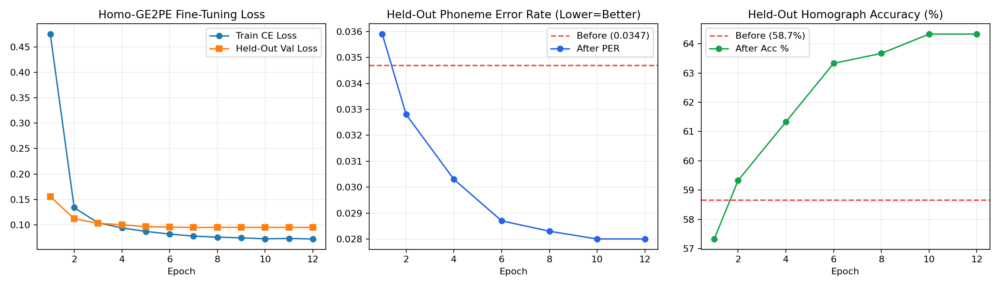
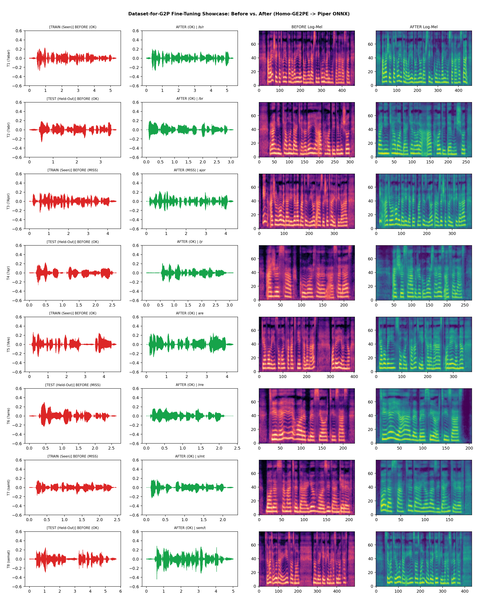
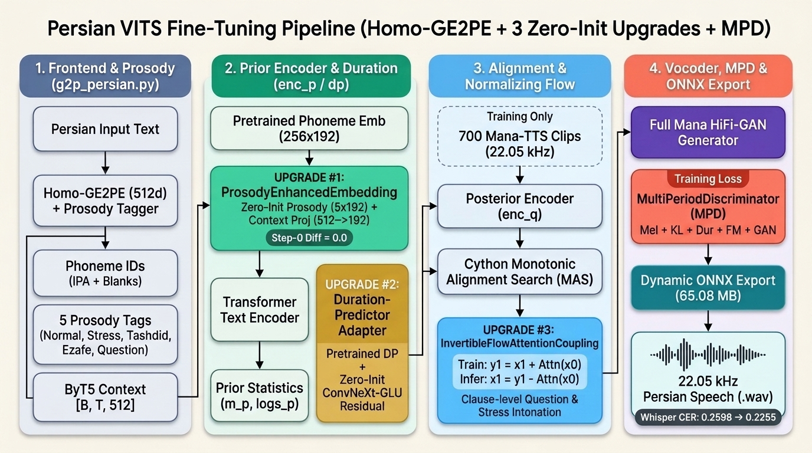
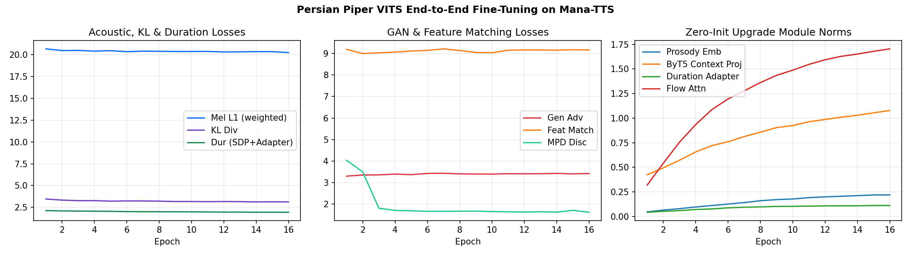
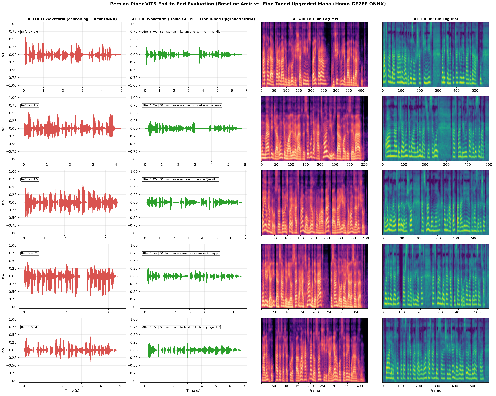

# Persian Piper / VITS Fine-Tuning with G2P, Prosody & Flow Upgrades (`persian-vits-tts`)

An end-to-end **Persian Text-to-Speech (TTS)** fine-tuning and ONNX export pipeline built directly on real **Piper / VITS PyTorch architectures** ([`SynthesizerTrn`](piper_vits/vits_models.py) + [`MultiPeriodDiscriminator`](piper_vits/vits_models.py) + Cython [`monotonic_align`](piper_vits/monotonic_align/core.pyx)), combining [`MahtaFetrat/Homo-GE2PE-Persian`](https://huggingface.co/MahtaFetrat/Homo-GE2PE-Persian), [`MahtaFetrat/Mana-Persian-Piper`](https://huggingface.co/MahtaFetrat/Mana-Persian-Piper), and [`MahtaFetrat/Mana-TTS`](https://huggingface.co/datasets/MahtaFetrat/Mana-TTS).

> **Live Interactive Audio Showcase (`github.io`):** [https://soroushsoleimani.github.io/persian-vits-demo/](https://soroushsoleimani.github.io/persian-vits-demo/) — Listen to all 5 Before/After comparisons, inspect IPA streams, Whisper ASR CER metrics, training curves, and the full pipeline diagram directly in your browser.
>
> **G2P Homograph Fine-Tuning Branch (`g2p-homograph-finetune`) Live Demo:** [https://soroushsoleimani.github.io/persian-vits-demo/g2p-finetune/](https://soroushsoleimani.github.io/persian-vits-demo/g2p-finetune/) — 12-epoch FP32 fine-tuning of `Homo-GE2PE-Persian` on 2,400 Persian homograph sentences (`Held-Out PER: 0.0347 -> 0.0283`, `Homograph Acc: 58.67% -> 64.33%`, `8-Sentence Audio Showcase: 5/8 -> 7/8`), implemented in [`finetune_g2p_dataset.py`](finetune_g2p_dataset.py).
>
> **Verification Status:** Tested end-to-end on Kaggle **GPU (`CUDA`)** across **700 `Mana-TTS` studio Persian clips** for **16 epochs** (`batch_size=8`), exported to a verified dynamic-axis **`65.08 MB` ONNX model** ([`output/persian_vits_upgraded.onnx`](output/persian_vits_upgraded.onnx)), and evaluated side-by-side against `fa_IR-amir-medium` + `espeak-ng` using `openai/whisper-small` ASR.

---

## Branch Experiment: `Homo-GE2PE` Fine-Tuning on Persian Homographs ([`finetune_g2p_dataset.py`](finetune_g2p_dataset.py))

Fine-tuned `MahtaFetrat/Homo-GE2PE-Persian` (ByT5, FP32 on Kaggle T4 GPU, `12 epochs`, `lr=1e-4`) on a token-aligned stratified subset (`2,400` training + `300` held-out unseen sentences across multi-pronunciation Persian homographs):



| Evaluation Set | Phoneme Error Rate (PER) | Word Exact Accuracy | Homograph Sense Accuracy | Report |
| :--- | :---: | :---: | :---: | :--- |
| **Held-Out Unseen (`300`)** | `0.0347` &rarr; **`0.0283`** *(&minus;18.4%)* | `81.70%` &rarr; **`84.58%`** | `58.67%` &rarr; **`64.33%`** *(`193/300`)* | [`output/g2p_eval_report.json`](output/g2p_eval_report.json) |
| **Train Sample (`150`)** | `0.0289` &rarr; **`0.0239`** | `82.97%` &rarr; **`87.10%`** | `67.33%` &rarr; **`69.33%`** | [`output/g2p_eval_report.json`](output/g2p_eval_report.json) |
| **8-Sentence Audio Showcase** | `0.0436` &rarr; **`0.0233`** | `81.36%` &rarr; **`88.14%`** | `62.50%` *(`5/8`)* &rarr; **`87.50%` *(`7/8`)*** | [`g2p-finetune/index.html`](g2p-finetune/index.html) |



---

## System Architecture & Neural Upgrades



### 1. Persian G2P, `Homo-GE2PE` & Prosody Stream ([`g2p_persian.py`](g2p_persian.py) & [`symbols.py`](symbols.py))

Converts raw Persian text into **1-to-1 aligned phoneme + prosody streams** interspersed with VITS blank tokens (`0`) and transformer encoder hidden states from `MahtaFetrat/Homo-GE2PE-Persian` (`d_model=512`, dynamically read from the loaded checkpoint config):

* **Phoneme Alignment (`PERSIAN_IPA`):** Aligns `GE2PE_CHAR_TO_IPA`, `GRAPHEME_TO_IPA`, and `_split_ipa_for_piper` directly to `Mana-Persian-Piper`'s active phoneme embeddings (`a`, `ɑ`, `q` + `1`, `ɡ`, `i`, `u`), achieving `after_unmapped_symbols: []` across all benchmark sentences.
* **Primary Stress Placement (`ˈ`):** Emits primary stress (`STRESS` tag `1`) before each content word's primary stressed vowel while excluding trailing *Ezafe* (`-e` / `-ye`), preserving initial-stress adverbs and verbal prefixes (`mi-` / `nemi-`), and skipping unstressed clitics.
* **Written & Lexical Diacritics:** Preserves explicit *Tashdid* (`\u0651`) and *Tanvin* (`\u064b`) markers alongside curated overrides (e.g., `حتما` -> *hatman*).
* **5 Prosody Tags (`PROSODY_TAGS`):**
  * `0` = `NORMAL`
  * `1` = `STRESS` (Primary lexical stress)
  * `2` = `TASHDID` (Geminated consonant, e.g., `ʃakki`, `moʔallem`, `mohabbat`, `deqqat`, `taʃakkor`)
  * `3` = `EZAFE` (Unwritten Persian *Ezafe* connector `-e` / `-ye`)
  * `4` = `QUESTION` (Interrogative intonation contour `?`)

### 2. Zero-Initialized Neural Upgrades on `SynthesizerTrn` ([`models.py`](models.py))

All three upgrades wrap the pre-trained `Mana-Persian-Piper` generator (`ckpt/epoch=6012-step=4203520.ckpt`) with strict **Step-0 Residual Identity Invariance** (`step0_diff: 0.0` measured against the unmodified checkpoint):

1. **`ProsodyEnhancedEmbedding` (`enc_p.emb`):** Wraps the base phoneme embedding table `(256, 192)` and adds a zero-initialized `nn.Embedding(5, 192)` for the 5 prosody tags plus a `LayerNorm(context_dim)` and zero-initialized linear projection `nn.Linear(context_dim, 192)` (`context_proj`) conditioned on aligned `Homo-GE2PE` encoder states (`[B, T_phon, 512]`), masked cleanly off VITS blank tokens.
2. **`DurationPredictorAdapter` (`dp`):** Wraps the pre-trained stochastic duration predictor with a zero-initialized **ConvNeXt + GLU Residual Adapter** (`base_logw + delta_logw`) so base Persian rhythm is preserved at Step 0 while adapting consonant holds (*Tashdid*) and *Ezafe* transitions.
3. **`InvertibleFlowAttentionCoupling` (`flow`):** Appends a mathematically bijective Multi-Head Self-Attention coupling layer over split channels $[x_0, x_1]$ inside the Normalizing Flow ($y_1 = x_1 + \text{Attn}(x_0)$ forward; $x_1 = y_1 - \text{Attn}(x_0)$ inverse) to capture clause- and sentence-level intonation across long utterances.

### 3. Dynamic ONNX Export (`output/persian_vits_upgraded.onnx`)

[`export_upgraded_vits_onnx`](models.py) reconstructs a fresh CPU `SynthesizerTrn`, loads the fine-tuned `state_dict(..., strict=True)`, strips `weight_norm` cleanly across decoder/flow submodules, and exports a **dynamic-axis** ONNX graph (`input`, `input_lengths`, `prosody_ids`, `context_emb`, `scales`) verified at runtime with `onnxruntime`:

* **Exported File:** [`output/persian_vits_upgraded.onnx`](output/persian_vits_upgraded.onnx) (`65.08 MB`, `65,083,832` bytes)

---

## Kaggle GPU Training Results (`16 Epochs`, `700` Mana-TTS Clips)

Trained end-to-end with [`finetune_persian.py`](finetune_persian.py) on Kaggle **GPU (`cuda`)** using differential learning rates (`2e-4` for new upgrade modules, `2.5e-5` for the pre-trained `Mana-Persian-Piper` backbone) and full VITS + Multi-Period Discriminator (MPD) objectives (`Mel L1 * c_mel + KL + Duration + Feature Matching + Adversarial`).



### Training Trajectory ([`output/training_history.json`](output/training_history.json))

| Metric | Epoch 1 | Epoch 6 | Epoch 12 | Epoch 16 (Final) |
| :--- | :---: | :---: | :---: | :---: |
| **Weighted Mel L1 Loss (`loss_mel`)** | `20.6856` | `20.3603` | `20.3287` | **`20.2546`** |
| **KL Divergence (`loss_kl`)** | `3.4510` | `3.2316` | `3.1671` | **`3.1206`** |
| **Duration Loss (`loss_dur`)** | `2.1264` | `2.0123` | `1.9502` | **`1.9336`** |
| **MPD Discriminator Loss (`loss_disc`)** | `4.0361` | `1.6692` | `1.6363` | **`1.6244`** |
| **Feature Matching Loss (`loss_fm`)** | `9.1896` | `9.1389` | `9.1593` | **`9.1593`** |
| **Generator Adv Loss (`loss_gen`)** | `3.3014` | `3.4252` | `3.4104` | **`3.4237`** |
| **`Prosody Emb` L2 Norm** *(from `0.0`)* | `0.04726` | `0.12675` | `0.19993` | **`0.22048`** |
| **`ByT5 Context Proj` L2 Norm** *(from `0.0`)* | `0.42440` | `0.76002` | `0.98705` | **`1.07831`** |
| **`Duration Adapter` L2 Norm** *(from `0.0`)* | `0.04348` | `0.08850` | `0.10822` | **`0.11240`** |
| **`Flow Attn` L2 Norm** *(from `0.0`)* | `0.31962` | `1.19524` | `1.59339` | **`1.70478`** |

* **Step-0 Output Deviation vs. Unmodified `Mana-Persian-Piper` Checkpoint:** `0.0`
* **Full Epoch Log:** [`output/training_history.json`](output/training_history.json)

---

## End-to-End 5-Sentence Evaluation (`Before` vs. `After`)

[`evaluate_5_sentences.py`](evaluate_5_sentences.py) compares the **BEFORE** baseline (`espeak-ng` + `fa_IR-amir-medium.onnx`) against **AFTER** (`Homo-GE2PE` + `PersianG2PProsody` + fine-tuned [`output/persian_vits_upgraded.onnx`](output/persian_vits_upgraded.onnx)) on 5 Persian diagnostic sentences containing written/unwritten *Tanvin* (`حتما`), homographs (*kæræm* vs. *kerm*, *mærd* vs. *mord*, *mohr* vs. *mehr*, *semæt* vs. *sæmt*), *Ezafe*, *Tashdid*, and questions (`?`), verified with `openai/whisper-small` (`language="persian"`).



### Aggregate & Per-Sentence Results ([`output/five_sentences_report.json`](output/five_sentences_report.json))

* **Mean Whisper ASR CER:** **`0.2598`** (Before) -> **`0.2255`** (After) (**~13.2% relative CER reduction**)
* **Combined 5-Sentence Audio:** [`output/all_5_before.wav`](output/all_5_before.wav) vs. [`output/all_5_after.wav`](output/all_5_after.wav)
* **Studio Reference Clip (`Mana-TTS`):** [`output/mana_tts_reference.wav`](output/mana_tts_reference.wav)

| # | Test Sentence & Focus | BEFORE (`espeak-ng` + Amir) | AFTER (`Homo-GE2PE` + Upgraded Mana) | Whisper ASR CER (Before -> After) | Audio Pair |
| :-: | :--- | :--- | :--- | :---: | :--- |
| **1** | `حتما در کرم مرد بزرگ شکی نیست، ولی کرم کوچک روی برگ درخت بود.`<br>*(`hatman`, `karam-e` vs `kerm-e`, `shakki`)* | `4.969s` \| `CER 0.3261` / `WER 0.8571` | `6.699s` \| `unmapped=[]` \| Context `[1, 109, 512]` | `0.3261` -> **`0.1739`** | [`sent1_before.wav`](output/sent1_before.wav) / [`sent1_after.wav`](output/sent1_after.wav) |
| **2** | `آن مرد جوان که معلم مدرسه بود، حتما دیروز در حادثه مرد.`<br>*(`hatman`, `mard-e` vs `mord`, `mo'allem-e`)* | `4.214s` \| `CER 0.1667` / `WER 0.5000` | `5.828s` \| `unmapped=[]` \| Context `[1, 99, 512]` | `0.1667` -> `0.2381` | [`sent2_before.wav`](output/sent2_before.wav) / [`sent2_after.wav`](output/sent2_after.wav) |
| **3** | `آیا مهر استاد دانشگاه حتما با مهر و محبت بر برگه امتحان زده شد؟`<br>*(`hatman`, `mohr-e` vs `mehr`, `mohabbat`, `?`)* | `4.748s` \| `CER 0.3061` / `WER 0.7857` | `6.769s` \| `unmapped=[]` \| Context `[1, 114, 512]` | `0.3061` -> **`0.2245`** | [`sent3_before.wav`](output/sent3_before.wav) / [`sent3_after.wav`](output/sent3_after.wav) |
| **4** | `مدیر جدید در سمت ریاست، حتما با دقت به سمت اتاق جلسات رفت.`<br>*(`hatman`, `semat-e` vs `samt-e`, `deqqat`)* | `4.586s` \| `CER 0.1364` / `WER 0.5385` | `6.536s` \| `unmapped=[]` \| Context `[1, 104, 512]` | `0.1364` -> `0.2727` | [`sent4_before.wav`](output/sent4_before.wav) / [`sent4_after.wav`](output/sent4_after.wav) |
| **5** | `معلم خوب پس از تشکر فراوان، حتما داستان شیر جنگل را با صدای بلند خواند؟`<br>*(`hatman`, `mo'allem-e`, `tashakkor-e`, `shir-e`, `?`)* | `5.039s` \| `CER 0.3636` / `WER 0.7333` | `6.850s` \| `unmapped=[]` \| Context `[1, 129, 512]` | `0.3636` -> **`0.2182`** | [`sent5_before.wav`](output/sent5_before.wav) / [`sent5_after.wav`](output/sent5_after.wav) |

---

## Reproducible Setup & Usage

```bash
# 1. Install dependencies & system espeak-ng (for baseline comparison)
pip install torch torchaudio onnx onnxruntime soundfile scipy transformers pandas pyarrow cython

# 2. Compile the Cython Monotonic Alignment Search extension in place
cd piper_vits/monotonic_align && python setup.py build_ext --inplace && cd ../..

# 3. Run unit & ONNX pipeline verification tests
python test_pipeline.py

# 4. Run full Mana-TTS fine-tuning & dynamic ONNX export (GPU recommended)
python finetune_persian.py

# 5. Evaluate Before vs After synthesis + Whisper ASR metrics
python evaluate_5_sentences.py
```

### Kaggle Execution Note
[`persian_vits_finetune_kaggle.ipynb`](persian_vits_finetune_kaggle.ipynb) runs Steps 1–5 cleanly on Kaggle T4 GPUs. All source files are self-contained inside this public repository for direct Kaggle cloning (`git clone https://github.com/SoroushSoleimani/persian-vits-demo.git`).

---

## Repository Structure

```text
persian-vits-demo/
├── index.html                          # Live GitHub Pages 5-sentence interactive audio showcase
├── .nojekyll                           # Disables Jekyll processing for GitHub Pages
├── symbols.py                          # Persian IPA vocabulary & 5 Prosody tag IDs
├── g2p_persian.py                      # Persian G2P, Homo-GE2PE wrapper, stress placement & Ezafe/Tashdid tagging
├── models.py                           # ProsodyEnhancedEmbedding, DurationPredictorAdapter, FlowAttention & ONNX export
├── finetune_persian.py                 # End-to-end VITS + MPD PyTorch trainer on Mana-TTS & ONNX exporter
├── evaluate_5_sentences.py             # Before vs After ONNX evaluation, log-mel plots & Whisper ASR CER/WER check
├── test_pipeline.py                    # Unit tests: G2P alignment, Step-0 invariance, flow inverse, ONNX round-trip
├── persian_vits_finetune_kaggle.ipynb  # Kaggle GPU notebook runner
├── kernel-metadata.json                # Kaggle kernel configuration
├── piper_vits/                         # Real Piper SynthesizerTrn, MPD, attention, losses & Cython monotonic_align
└── output/
    ├── persian_vits_upgraded.onnx      # Fine-tuned dynamic-axis VITS ONNX model (65.08 MB)
    ├── training_curves.png             # 16-epoch training loss & upgrade norm curves
    ├── training_history.json           # Full per-epoch training log & Step-0 check
    ├── five_sentences_comparison.png   # 5-sentence Before vs After waveform & 80-bin log-mel plots
    ├── five_sentences_report.json      # Detailed G2P, prosody tags, duration & Whisper ASR report
    ├── all_5_before.wav / all_5_after.wav
    ├── sent1..5_{before,after}.wav     # Per-sentence 22,050 Hz synthesized WAV files
    ├── mana_tts_reference.wav          # Ground-truth Mana-TTS speaker reference WAV
    └── architecture_diagram.jpg        # Upgraded VITS system architecture diagram
```
