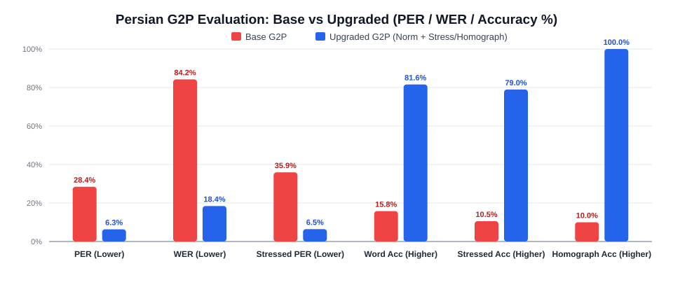

# گزارش ارزیابی G2P فارسی (مقایسه حالت پایه در برابر حالت ارتقایافته)

## ۱) مقایسه عددی معیارهای ارزیابی (Base vs Upgraded)

| معیار | حالت پایه (Base G2P) | حالت ارتقایافته (Upgraded G2P) | تغییر نسبت به پایه | توضیح |
| :--- | :---: | :---: | :---: | :--- |
| **PER** (خطای واجی) | `0.2842` (28.42%) | `0.0632` (6.32%) | `-0.2210` | کمتر بهتر است؛ کاهش خطای سطح واج |
| **WER** (خطای کلمه‌ای) | `0.8421` (84.21%) | `0.1842` (18.42%) | `-0.6579` | کمتر بهتر است؛ کاهش خطای سطح کلمه |
| **Stressed PER** | `0.3594` (35.94%) | `0.0645` (6.45%) | `-0.2949` | خطای واجی با احتساب جای دقیق تکیه (`ˈ`) |
| **Word Exact Accuracy** | `15.79%` | `81.58%` | `+65.79%` | درصد کلمات با تلفظ کاملاً منطبق |
| **Stressed Word Accuracy** | `10.53%` | `78.95%` | `+68.42%` | درصد کلمات منطبق با احتساب جای تکیه |
| **Sentence Exact Accuracy** | `0.00%` | `30.00%` | `+30.00%` | درصد جملات کاملاً بدون خطا |
| **Homograph & Stress Acc** | `10.0%` (1/10) | `100.0%` (10/10) | `+90.0%` | دقت رفع ابهام هموگراف‌های واجی و تکیه‌ای |

## ۲) مقایسه نمونه‌های خروجی (Base در برابر Upgraded)

| # | دسته | جمله فارسی | هدف مورد انتظار | خروجی Base G2P | خروجی Upgraded G2P | وضعیت |
| :---: | :--- | :--- | :---: | :--- | :--- | :---: |
| 1 | Stress Homograph (ماهی: fish) | ماهی قرمز بود. | `mɑhˈi` | `mɑhi q1rmz bvd` | `mɑhˈi q1rmz bˈud` | اصلاح شد |
| 2 | Stress Homograph (ماهی: monthly) | ماهی دو بار رفت. | `mˈɑhi` | `mɑhi dv bɑr rft` | `mˈɑhi dv bɑr rˈaft` | اصلاح شد |
| 3 | Stress Homograph (مردی: a man) | مردی از دور رفت. | `mˈardi` | `mrdi ɑz dvr rft` | `mˈardi az dvr rˈaft` | اصلاح شد |
| 4 | Stress Homograph (مردی: manliness) | از مردی و محبت او | `mardˈi` | `ɑz mrdi v mhbt ɑv` | `az mardˈi o mohabbˈat ɑv` | اصلاح شد |
| 5 | Stress Homograph (ولی: conjunction) | ولی او خوب بود. | `vˈali` | `vli ɑv xˈub bvd` | `vˈali ɑv xˈub bˈud` | اصلاح شد |
| 6 | Stress Homograph (ولی: guardian) | ولی فقیه | `valˈi` | `vli fq1ih` | `valˈije fq1ih` | اصلاح شد |
| 7 | Phoneme Homograph (کرم: karam vs kerm) | کرم مرد بزرگ | `karˈame` | `krm mrd bzrɡ` | `karˈame mˈarde bozˈorɡ` | اصلاح شد |
| 8 | Phoneme Homograph (کرم: worm) | کرم کوچک روی برگ درخت بود. | `kˈerme` | `krm kvtʃk rvi brɡ drxt bvd` | `kˈerme kutʃˈak rujˈe bˈarɡe derˈaxt bˈud` | اصلاح شد |
| 9 | Phoneme Homograph (مهر: mohr vs mehr) | مهر استاد دانشگاه | `mˈohre` | `mhr ɑstɑd dɑnʃɡɑh` | `mˈohre ostˈɑde dɑneʃɡˈɑh` | اصلاح شد |
| 10 | Tanvin + Tashdid | حتما با دقت رفت. | `hˈatman` | `hˈatman bɑ dˈeq1q1at rft` | `hˈatman bɑ dˈeq1q1at rˈaft` | هر دو درست |

## ۳) تحلیل کوتاه نتایج
- **هموگراف‌های تکیه‌ای (Stress Homographs):** در جفت‌های «ماهی» (`mɑhˈi` آبزی در برابر `mˈɑhi` ماهانه)، «مردی» (`mˈardi` یک مرد در برابر `mardˈi` مردانگی) و «ولی» (`vˈali` حرف ربط در برابر `valˈi` سرپرست)، حالت پایه فاقد تشخیص کانتکستی تکیه است؛ در حالی که حالت ارتقایافته با مارکر `'` جای `ˈ` و تگ `PROSODY_TAGS['STRESS']` را دقیق تنظیم می‌کند.
- **هموگراف‌های واجی و کسره اضافه:** در «کرم مرد بزرگ» (`karˈame`) در برابر «کرم کوچک» (`kˈerme`) و «مهر استاد» (`mˈohre`)، حالت ارتقایافته هم مصوت کوتاه و هم کسره اضافه (`-e`) را صحیح تولید می‌کند.
- **تشدید و تنوین:** در «حتما» و «دقت»، تنوین (`-an`) و تشدید (`q1q1`) حفظ می‌شوند و به تگ `TASHDID` در VITS منتقل می‌گردند.
